# BIZINSIGHT Enterprise Architecture & Technical Specification

## 1. System Overview

**BIZINSIGHT** is a unified, production-grade Decision Intelligence, Predictive Analytics, and Governed Business Intelligence platform. It combines automated ETL pipelines, AST-verified zero-hallucination semantic query engines, machine learning operations (MLOps), and econometric decision modeling into a secure, multi-tenant enterprise solution.

---

## 2. Architecture Diagram

```mermaid
flowchart TD
    subgraph ClientLayer["Client & UI Layer"]
        UI["React 18 + Vite + Tailwind CSS + Lucide Icons"]
        NLQTab["Governed NLQ Studio"]
        DIMonitor["Decision Intelligence & Digital Twin"]
        MLOpsUI["MLOps Lifecycle & Drift Dashboard"]
    end

    subgraph APIGateway["API Gateway & Security Layer (FastAPI)"]
        Router["FastAPI Application Router (/api/v1)"]
        Auth["JWT Auth & PBKDF2 Password Hashing"]
        RBAC["RBAC Engine (Admin, Decision-Maker, ML Engineer, Analyst)"]
        Audit["JSONL & Append-Only Cryptographic Audit Log"]
        MetricsMW["Prometheus Metrics Middleware (/metrics)"]
    end

    subgraph CoreEngines["Analytics & Intelligence Engines"]
        NLQ["Deterministic Text-to-SQL & Ollama Semantic Layer"]
        AST["AST Code Safety & Sandbox Verifier"]
        DI["Decision Intelligence & Prescriptive Optimizer"]
        Twin["Digital Twin Scenario Engine"]
        Causal["Econometric Causal Rigor Evaluator"]
        Forecasting["Chronological Quantile Forecaster (XGBoost)"]
        Anomaly["Isolation Forest Multivariate Outlier Engine"]
        Segmentation["RFM K-Means Customer Clustering"]
        SHAPEngine["TreeSHAP Explainability & Attribution"]
    end

    subgraph DataPlatform["Data Platform & Persistence"]
        Postgres[("PostgreSQL 16 Multi-tenant Database")]
        RedisCache[("Redis 7 In-Memory Cache with TTL Fallback")]
        ParquetLake["Embedded Parquet Data Lake"]
        ModelStore["MLOps Model Registry & Artifact Store"]
    end

    subgraph Observability["Observability & Reliability"]
        Prometheus["Prometheus Metrics Exporter"]
        HealthProbes["Liveness, Readiness & Deep Dependency Probes"]
        IncidentSRE["Operations Center & Telemetry Monitor"]
    end

    UI --> Router
    NLQTab --> Router
    DIMonitor --> Router
    MLOpsUI --> Router

    Router --> Auth
    Auth --> RBAC
    RBAC --> Audit
    Router --> MetricsMW

    Router --> NLQ
    Router --> AST
    Router --> DI
    Router --> Twin
    Router --> Causal
    Router --> Forecasting
    Router --> Anomaly
    Router --> Segmentation
    Router --> SHAPEngine

    NLQ --> RedisCache
    NLQ --> Postgres
    Forecasting --> RedisCache
    Forecasting --> Postgres
    DI --> ModelStore
    DI --> Postgres
    DataPlatform --> ParquetLake

    Router --> Observability
    MetricsMW --> Prometheus
    HealthProbes --> Postgres
    HealthProbes --> RedisCache
```

---

## 3. Core Enterprise Capabilities

### 3.1 Governed Natural Language Query (NLQ) & Semantic Store
- **AST Verification**: SQL statements generated via Natural Language Query are pre-parsed using `sqlparse` and Python AST validators to reject mutating or malicious commands (`DROP`, `DELETE`, `UPDATE`, `EXEC`, semicolon chaining).
- **Zero-Hallucination Compliance**: Deterministic column and metric mapping strictly limits queries to curated catalog schemas.

### 3.2 Decision Intelligence & Econometric Causal Modeling
- **Prescriptive Optimization**: Calculates multi-constraint boundary plans across revenue targets, marketing spend thresholds, and minimum margin constraints.
- **Digital Twin Simulation**: Parameterized what-if simulation modeling revenue, marketing delta, price sensitivity, and staffing dynamics.
- **Causal Econometrics**: Computes causal impact estimates using do-calculus and synthetic difference-in-differences.

### 3.3 MLOps Model Lifecycle & Drift Telemetry
- **Model Registry**: Full version lineage ($v1 \dots v7$) tracking algorithms (ARIMA, Prophet, Random Forest, LightGBM, XGBoost Enterprise), evaluation metrics (MAE, RMSE, Accuracy), and lifecycle states:
  $$\text{TRAINED} \rightarrow \text{EVALUATION} \rightarrow \text{VALIDATION} \rightarrow \text{PENDING\_APPROVAL} \rightarrow \text{STAGING} \rightarrow \text{PRODUCTION}$$
- **Telemetry & Drift Engine**: Monitors Population Stability Index (PSI), feature drift, prediction drift, and latency percentiles ($p50$, $p95$).

### 3.4 Resilient Multi-Tier Caching
- **Redis Primary with In-Memory TTL Fallback**: Queries and computed analytics are cached in Redis with configurable TTLs. If Redis is unavailable, the system automatically falls back to an in-memory thread-safe TTL store with zero disruption.

### 3.5 Role-Based Access Control (RBAC) & Governance
- **Role Hierarchy**:
  $$\text{Admin} \supset \text{Decision-Maker} \supset \text{ML Engineer} \supset \text{Analyst} \supset \text{User}$$
- **Cryptographic Audit Log**: Every query, user action, and model lifecycle transition is committed to structured JSONL logs with UTC timestamps and user attribution.

---

## 4. Deployment Architecture

### 4.1 Multi-Container Orchestration (`docker-compose.yml`)
- **PostgreSQL 16 Alpine**: Relational persistence with volume-backed storage and health checks.
- **Redis 7 Alpine**: Fast caching tier with automated memory management.
- **Backend**: Multi-stage lightweight Python 3.11 container running FastAPI and Uvicorn.
- **Frontend**: Multi-stage Node 20 / Nginx Alpine container serving optimized React assets.
- **Ollama**: Local containerized LLM runtime for offline semantic translations.

### 4.2 Kubernetes Cloud-Native Deployment (`helm/bizinsight`)
- **Horizontal Scaling**: Independent replica counts and resource request/limit controls for Backend and Frontend.
- **Readiness & Liveness Probes**: Deep health checking verifying database and cache connectivity.
- **Ingress Controller**: TLS termination, prefix routing (`/api` $\rightarrow$ Backend, `/` $\rightarrow$ Frontend), and rate limiting.
